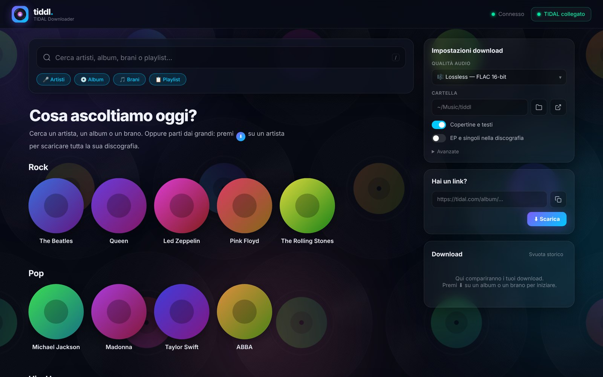
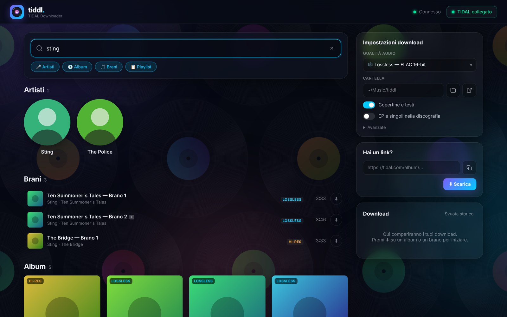
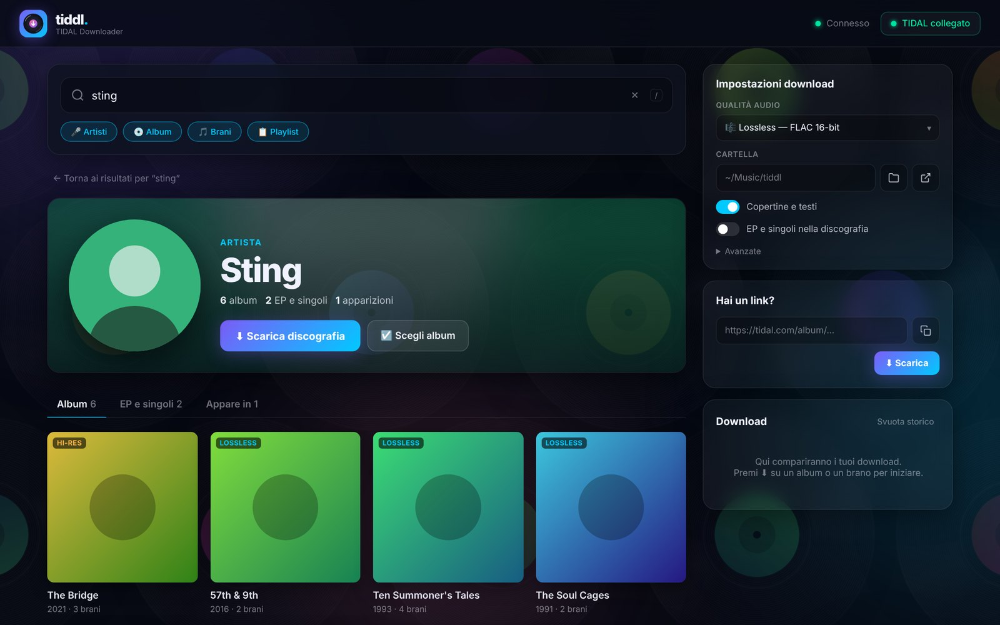
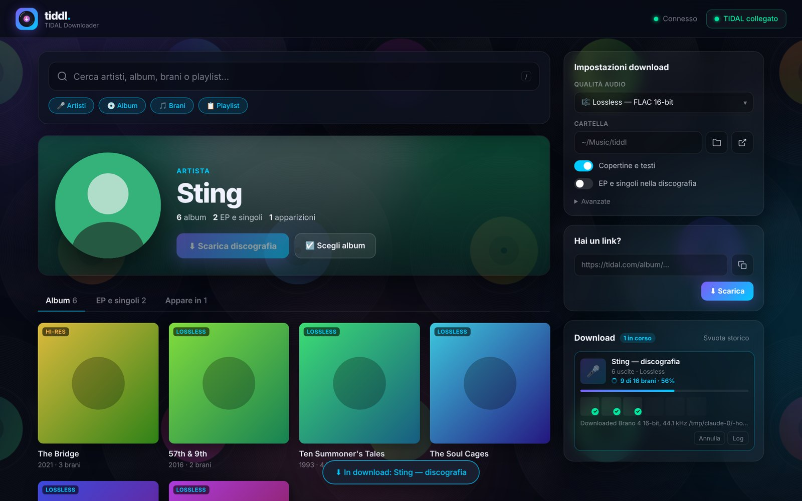
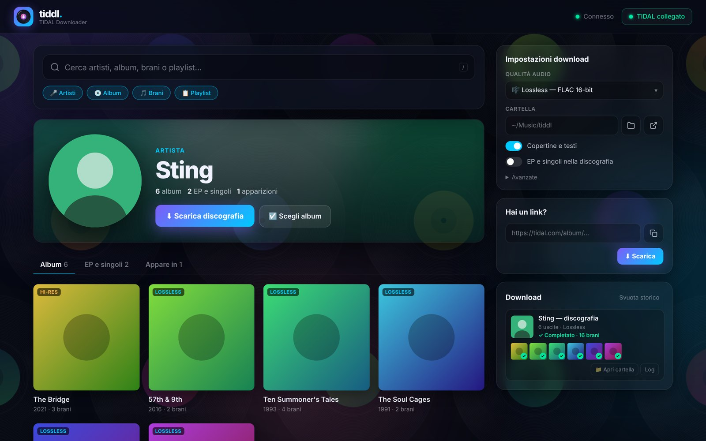
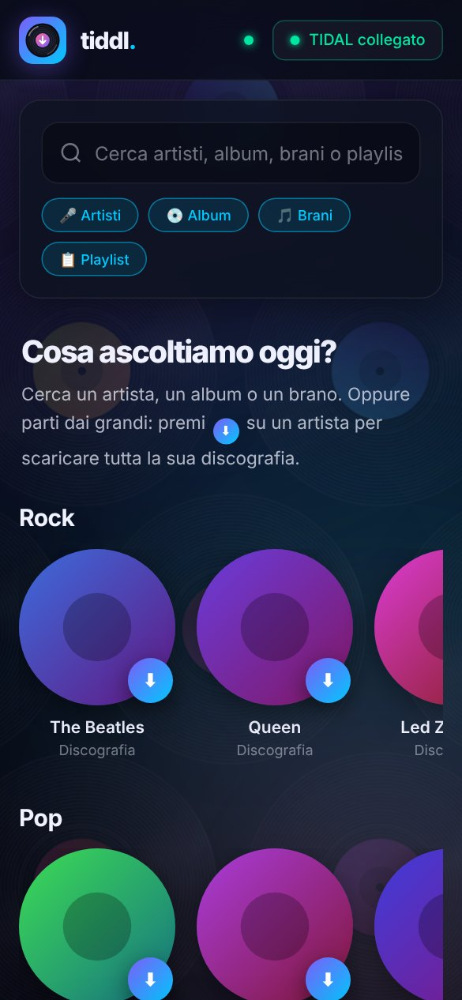

# 🎵 Tiddl-GUI

Un'interfaccia web elegante e veloce per scaricare musica in alta qualità da TIDAL, basata sul downloader [tiddl](https://github.com/oskvr37/tiddl).

## ✨ Funzioni

- **Ricerca immediata** di artisti, album, brani e playlist, con anteprima delle copertine.
- **Discografia in un clic**: premi ⬇ su un artista (dalla home, dai risultati o dalla sua pagina) per scaricare tutti gli album, con opzione per EP e singoli.
- **Scegli album**: seleziona solo alcune uscite e scaricale insieme.
- **Brani singoli**, album e playlist con un solo pulsante, oppure incolla un link TIDAL.
- **Coda download dal vivo**: avanzamento, mosaico delle copertine che si completano, log in tempo reale, annulla e storico.
- **Sfoglia cartella**: scegli dove salvare con il selettore nativo di macOS e aprila nel Finder.
- **Qualità audio** a scelta: Max (Hi-Res), Lossless FLAC, AAC 320k, AAC 96k.
- **Copertine e testi** incorporati nei file.
- **Vetrina per genere** con gli artisti più famosi (Rock, Pop, Hip-Hop…) e uno sfondo a vinili animati, non invasivo.
- **Layout responsive**, che si adatta anche agli schermi piccoli.

| Ricerca | Pagina artista |
|---|---|
|  |  |
| **Download in corso** | **Download completato** |
|  |  |

> Le immagini sono state generate con dati di prova: le copertine e le foto degli artisti sono segnaposto.

## 🚀 Avvio rapido

1. Installa il CLI tiddl (la v3 richiede Python 3.13+) e ffmpeg:
   `pipx install "tiddl>=3"` · `brew install ffmpeg`
2. Installa le dipendenze: `npm install`
3. Avvia il server: `node server.js` (su macOS puoi anche fare doppio clic su `avvia.command`)
4. Apri `http://localhost:7432`
5. Premi **Accedi a TIDAL**, conferma nel browser e inizia a scaricare.

### Variabili d'ambiente

| Variabile | Default | Descrizione |
|---|---|---|
| `PORT` | `7432` | Porta del server |
| `HOST` | `127.0.0.1` | Indirizzo di ascolto (solo locale per default) |
| `TIDDL_BIN` | auto | Percorso completo dell'eseguibile `tiddl`, se non viene trovato da solo |
| `TIDDL_PATH` | `~/.tiddl` | Cartella di configurazione e login di tiddl |

La GUI modifica soltanto le sezioni `[metadata]` e `[cover]` di `~/.tiddl/config.toml`; il resto della tua configurazione resta intatto.

## 🛠️ Tecnologie

- **Backend**: Node.js, Express, WebSocket (`ws`)
- **Downloader**: [tiddl](https://github.com/oskvr37/tiddl) (CLI)
- **Frontend**: JavaScript puro e CSS (tema scuro in stile vetro)

---
*Avvertenza: questo strumento è a scopo educativo. Sostieni gli artisti abbonandoti a TIDAL.*
